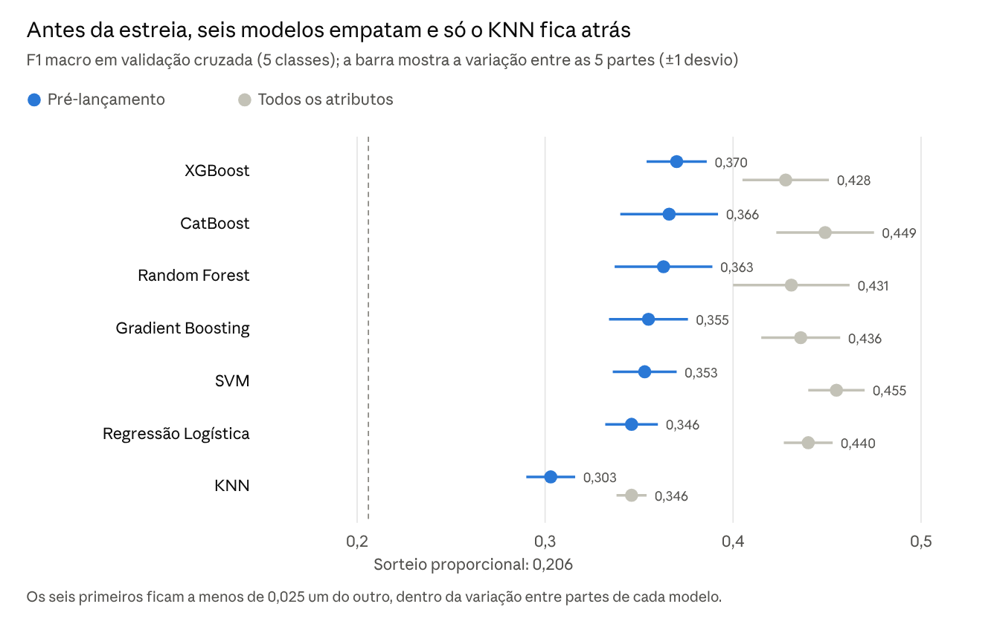
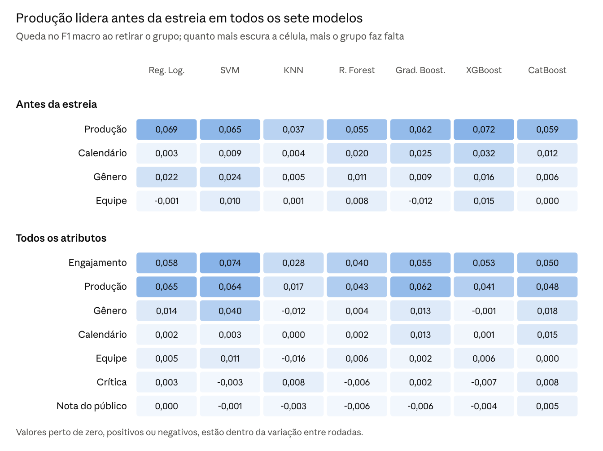

# Predição do sucesso de bilheteria de filmes

Pesquisa de Iniciação Científica (DECOM/UFOP), orientada pelo Prof. Dr. Guilherme Tavares de Assis.

O objetivo é **classificar o sucesso financeiro de um filme** a partir de dados públicos e entender **quais atributos realmente explicam esse sucesso**. O sucesso é medido pelo multiplicador bilheteria ÷ orçamento, e não pela bilheteria absoluta.

> 🇺🇸 **English summary:** Undergraduate research on predicting a movie's financial success (box office ÷ budget, in 5 ordinal classes) from public data (TMDB + OMDb, 3,212 films since 1980). Seven models were compared (Logistic Regression, SVM, KNN, Random Forest, Gradient Boosting, XGBoost, CatBoost) with permutation importance and group ablation. Main findings: before release, budget and franchise are the top-2 features in all seven models; critic and audience scores add nothing once other features are known; and six of the seven models tie in performance (macro F1 0.346 to 0.370), which suggests the ceiling lies in the available features rather than in the choice of model.

**Status:** em andamento. A etapa atual é a escolha e o ajuste do modelo final.

---

## Principais resultados

- **Os 7 modelos concordam sobre o que importa.** Antes da estreia, **orçamento** e **franquia** são o 1º e o 2º atributos em todos eles, e o **ano** fica entre os cinco primeiros em todos.
- **Crítica e nota do público não acrescentam nada.** Quando o modelo já conhece os outros atributos, retirar o Rotten Tomatoes, o Metascore e as notas do IMDb e do TMDB não muda o desempenho.
- **Seis modelos empatam.** Com 5 classes e só informação disponível antes da estreia, XGBoost, CatBoost, Random Forest, Gradient Boosting, SVM e Regressão Logística ficam entre **0,346 e 0,370 de F1 macro**. Essa diferença é do tamanho da variação entre as partes da validação cruzada. O sorteio proporcional fica em 0,206.
- **O limite está nos atributos, não no modelo.** Um modelo linear simples chega quase ao resultado do XGBoost, e todos têm a mesma dificuldade com a faixa de 1x a 2x.
- **O Grande sucesso tem um perfil próprio:** filmes baratos (orçamento mediano de US$ 13 mi), com muito terror (25%) e franquias (54%).



---

## Dados

| Etapa | Filmes |
|---|---|
| Coletados (TMDB + OMDb, lançados de 1980 em diante) | 4.000 |
| Com orçamento e bilheteria informados | 3.278 |
| Sem lançamentos recentes (bilheteria incompleta) | 3.218 |
| Orçamento a partir de US$ 100 mil (abaixo disso costuma ser erro de cadastro) | **3.212** |

A coleta usa a API do **TMDB** para listar os filmes, com detalhes e créditos de cada um. Depois cruza pelo `imdb_id` com a **OMDb**, que traz as notas do IMDb, do Metacritic e do Rotten Tomatoes. São 34 atributos por filme.

Para validar a base, montei um **gabarito com 9 filmes de resultado conhecido**, entre eles Avatar, Get Out, Dune, John Carter e The Flash. Os 9 caíram na classe esperada.

## Variável-alvo: 5 classes de sucesso

O multiplicador (bilheteria mundial ÷ orçamento de produção) foi dividido em 5 classes. Os cortes de 2x e 4x seguem o ponto de equilíbrio descrito por Vogel em *Entertainment Industry Economics*: a bilheteria precisa cobrir também o marketing e a parte que fica com os cinemas.

| Classe | Multiplicador | Filmes | % |
|---|---|---|---|
| Prejuízo | < 1x | 512 | 15,9% |
| Fracasso | 1x a 2x | 623 | 19,4% |
| Mediano | 2x a 4x | 1.005 | 31,3% |
| Sucesso | 4x a 8x | 676 | 21,0% |
| Grande sucesso | ≥ 8x | 396 | 12,3% |

Os cortes dobram a cada classe porque o multiplicador é uma razão. As 5 classes refinam as 3 classes originais (< 2x, 2x a 4x, ≥ 4x), o que permite comparar os dois esquemas diretamente.

## Atributos

Os atributos estão separados em grupos e, principalmente, pelo que **já se sabe antes da estreia**:

| Grupo | Exemplos | Antes da estreia? |
|---|---|---|
| Produção | orçamento (log), duração, franquia, idioma, classificação etária | Sim |
| Gênero | uma coluna 0/1 por gênero | Sim |
| Equipe | desempenho anterior do diretor, do elenco e do estúdio | Sim |
| Calendário | ano, verão americano, fim de ano | Sim |
| Crítica | Metascore, Rotten Tomatoes | Não |
| Nota do público | nota IMDb, nota TMDB | Não |
| Engajamento | votos IMDb e TMDB, popularidade | Não |

O **histórico da equipe** usa só filmes lançados *antes* de cada filme. Se usasse a filmografia inteira, o modelo veria parte da resposta (vazamento de dados).

## Metodologia

- **Métrica principal: F1 macro.** Dá o mesmo peso a cada classe, e a acurácia engana com classes desbalanceadas. Como as classes têm ordem, também meço o acerto ±1 classe e o erro médio em número de classes.
- **Validação cruzada estratificada em 5 partes**, mais uma **divisão temporal**: treino com filmes até 2019 e teste com os de 2020 em diante, que simula o uso real.
- **Linhas de base:** chutar sempre a classe mais comum e sortear a classe respeitando as proporções.
- **Busca aleatória de hiperparâmetros** para os 7 modelos. A busca usa divisões diferentes das usadas na avaliação.
- **Importância por permutação** em vez da importância nativa das árvores. Uma coluna de ruído aleatório recebia cerca de 5% na nativa e zero na permutação.
- **Ablação por grupo:** retiro um grupo inteiro e meço a queda no F1. Isso evita que atributos redundantes escondam uns aos outros.
- **Agrupamento hierárquico** (correlação de Spearman) e **análise fatorial**, para encontrar atributos redundantes.



## Desempenho (5 classes, validação cruzada)

| Modelo | F1 macro (antes da estreia) | F1 macro (todos os atributos) |
|---|---|---|
| XGBoost | **0,370** | 0,428 |
| CatBoost | 0,366 | 0,449 |
| Random Forest | 0,363 | 0,431 |
| Gradient Boosting | 0,355 | 0,436 |
| SVM | 0,353 | **0,455** |
| Regressão Logística | 0,346 | 0,440 |
| KNN | 0,303 | 0,346 |
| *Sorteio proporcional* | *0,206* | |
| *Chutar sempre "Mediano"* | *0,095* | |

Como modelo de regressão do log do multiplicador, a Random Forest explica **R² = 0,235** da variação só com informação disponível antes da estreia, e **0,406** com todos os atributos. Os resultados da primeira etapa estão em [`resultados/analise_inicial/`](resultados/analise_inicial/).

## Limitações

- **Viés de seleção:** filmes antigos e estrangeiros que chegam ao TMDB tendem a ser os de sucesso.
- **Orçamento sem correção pela inflação.**
- **A faixa de 1x a 2x (Fracasso) é difícil para todos os modelos:** a maioria desses filmes é prevista como Mediano.
- **Mercado diferente depois de 2020** (pandemia e streaming): o desempenho cai na divisão temporal.

## Próximos passos

- Confirmar o empate entre os modelos com testes estatísticos, repetindo a validação cruzada com várias sementes.
- Criar atributos novos, já que é ali que está o limite: orçamento corrigido pela inflação, marketing e concorrência no fim de semana de estreia.
- Dar mais peso às classes pequenas no treino.
- Montar o modelo final com XGBoost/CatBoost, Gradient Boosting e Regressão Logística.

---

## Estrutura

```
coleta/
  coleta_filmes.py            # coleta TMDB + OMDb
  adicionar_multiplicador.py  # calcula bilheteria ÷ orçamento
  teste_gabarito.py           # valida a base com 9 filmes conhecidos
analises/
  1_analise_completa.py       # clusters, regressão, permutação, grupos (3 classes)
  2_analise_5_classes.py      # 3 contra 5 classes e perfil das classes
  3_comparacao_modelos.py     # 7 modelos, busca de parâmetros, concordância
figuras/                      # gráficos dos relatórios
resultados/analise_inicial/   # tabelas da primeira análise
dados/                        # CSVs gerados pela coleta (fora do git)
```

## Como reproduzir

```bash
pip install -r requirements.txt
cp .env.example .env          # preencha com suas chaves do TMDB e da OMDb

python coleta/coleta_filmes.py
python coleta/adicionar_multiplicador.py
python coleta/teste_gabarito.py

python analises/1_analise_completa.py     # alguns minutos
python analises/2_analise_5_classes.py    # 20 a 40 minutos
python analises/3_comparacao_modelos.py   # 1 a 2 horas
```

Rode os comandos a partir da raiz do repositório. O dataset não é distribuído aqui por causa dos termos de uso das APIs, mas o script de coleta reconstrói a base.

**Stack:** Python · pandas · NumPy · SciPy · scikit-learn · XGBoost · CatBoost · Matplotlib
